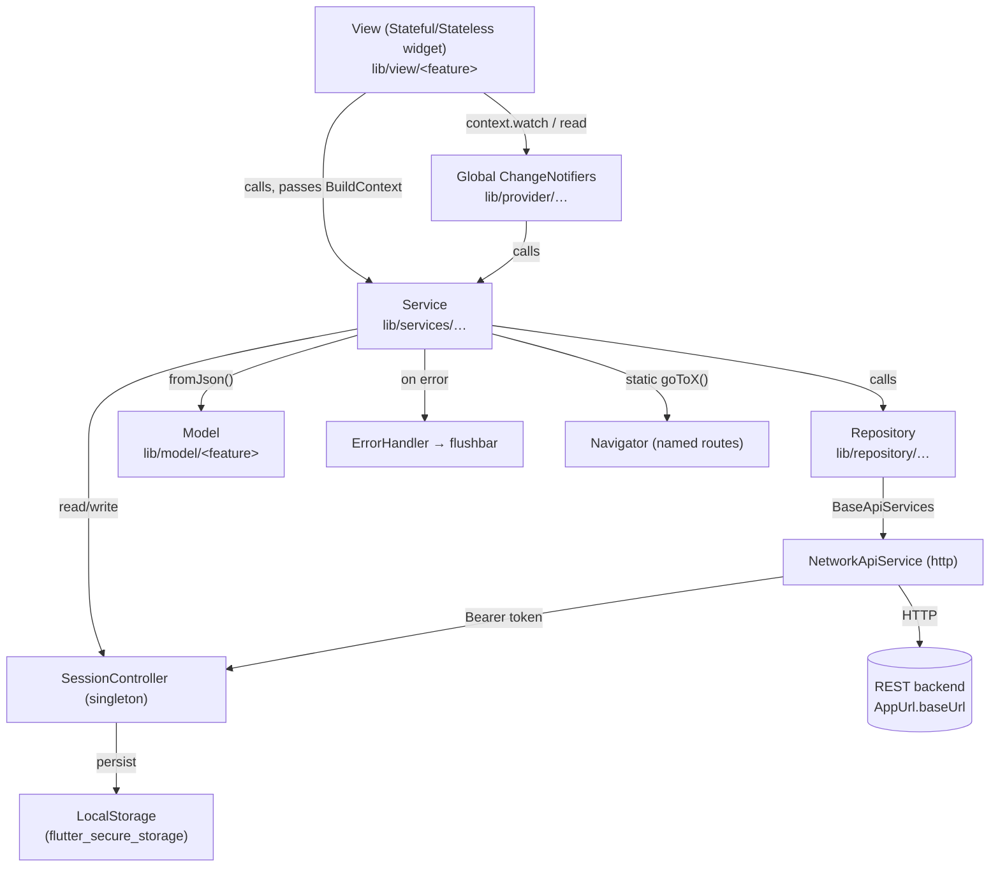
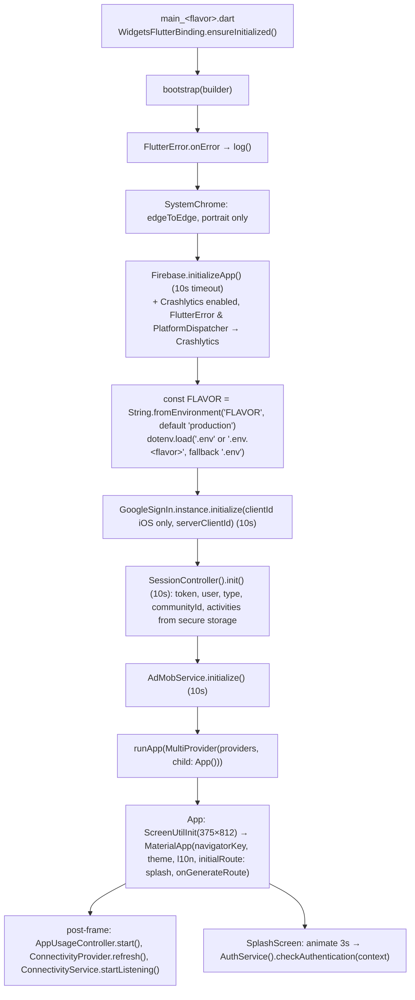
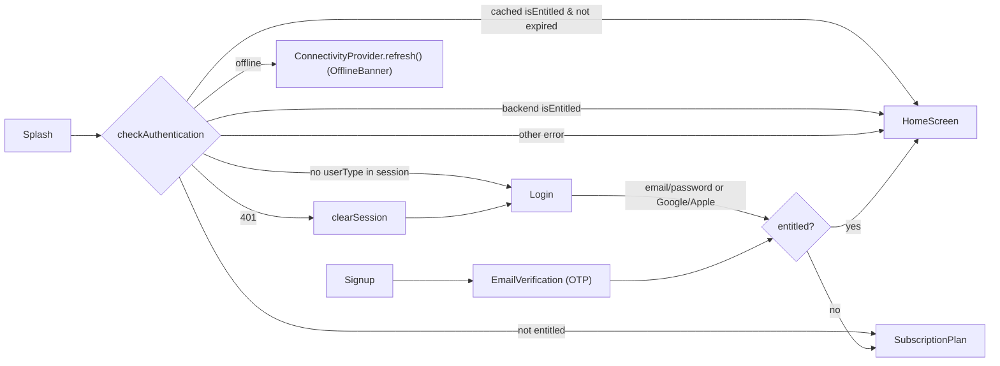
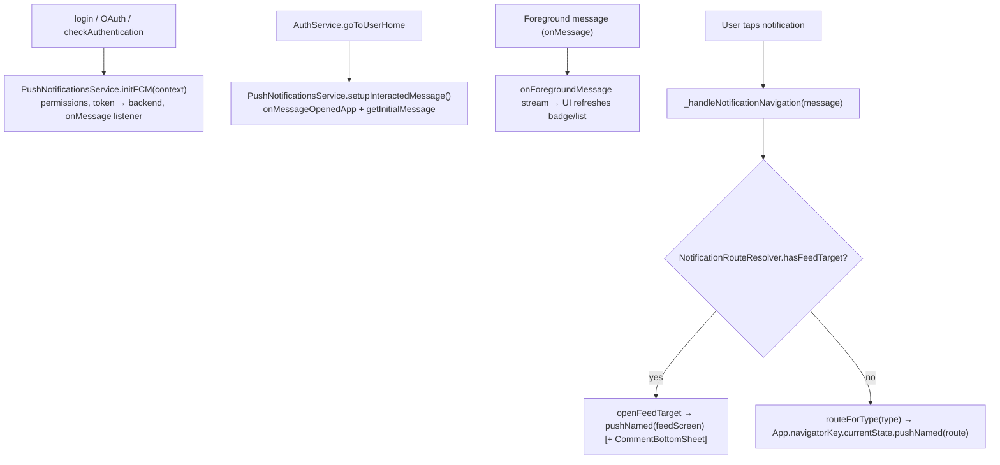
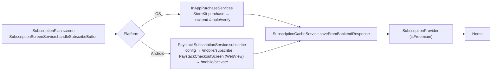

# AGENTS.md — kena (Flutter)

Guide for AI coding agents working on this repository, or reproducing its architecture in another project.

Everything here comes from reading the source and config files. Statements are **verified** unless marked:

- **[Unverified]**: could not be confirmed from the code (it depends on the backend, on runtime behaviour, or on files outside the repo).
- **[Observation]**: a quirk, inconsistency or risk found in the code. It is documented so agents don't "fix" it by accident, and don't copy it into new projects without thinking.

---

## 0. Quick facts

| Item | Value |
|---|---|
| Dart package name | `kena_emotional_journey` (all imports use `package:kena_emotional_journey/...`) |
| App display name | `kena` / `kena.life` (see §9) |
| Version | `1.0.0+16` (`pubspec.yaml`) |
| Dart SDK | `^3.8.1` (the code uses Dart 3.8 null-aware map elements: `'fcmToken': ?fcmToken`) |
| Origin | Scaffolded with Very Good CLI (`README-DEV.md`), then heavily customised |
| State management | `provider` (`ChangeNotifier`) for global state, plus `setState` for screen state |
| HTTP | `package:http`, wrapped in `NetworkApiService` |
| Navigation | Named routes through `MaterialApp.onGenerateRoute` |
| DI | No container. Direct instantiation, singletons, optional constructor injection |
| Backend | One REST backend, base URL hard-coded in `lib/app/utils/app_url.dart` |
| Firebase | Core, Crashlytics, Messaging (FCM). Analytics is declared in pubspec but not imported anywhere |
| Payments | iOS: Apple In-App Purchase. Android: Paystack hosted checkout in a WebView |
| Ads | Google Mobile Ads (AdMob) for Freemium users |
| Platforms configured | Android, iOS (`macos/` and `web/` folders exist but aren't covered here) |
| Tests | None active (`test/widget_test.dart` is fully commented out) |

---

## 1. Project folder structure

```
kena_phase2/
├── AGENTS.md                      ← this file
├── pubspec.yaml                   ← deps, assets, fonts, flutter_gen + launcher icon config
├── analysis_options.yaml          ← includes package:flutter_lints/flutter.yaml only
├── flavorizr.yaml                 ← flutter_flavorizr flavor definitions (dev/stg/prod)
├── .env                           ← runtime secrets loaded by flutter_dotenv (gitignored, but bundled as an asset)
├── .vscode/launch.json            ← 9 launch configs (3 flavors × debug/profile/release)
├── README-DEV.md                  ← original Very Good CLI readme (partly outdated, see §13)
├── PAYSTACK_API_DOCUMENTATION.md  ← backend Paystack subscription API reference
├── assets/
│   ├── fonts/                     ← Inter, Raleway, ZenAntiqueSoft, SF Pro, SF Pro Display
│   ├── icons/ (+ icons/logo/)     ← SVG/PNG icons (accessed via flutter_gen `Assets.icons…`)
│   ├── images/
│   └── json/map_styles/           ← night_theme.json (leftover from map feature)
├── android/                       ← Groovy Gradle build with productFlavors (see §9)
├── ios/                           ← per-flavor build configs, schemes, GoogleService plists
├── legal/, public/                ← static legal pages / web assets (not used by Dart code)
├── test/widget_test.dart          ← commented out
└── lib/
    ├── main_development.dart      ← entrypoint → bootstrap(() => App())
    ├── main_staging.dart          ← entrypoint → bootstrap(() => const App())
    ├── main_production.dart       ← entrypoint → bootstrap(() => const App())
    ├── bootstrap.dart             ← all app initialisation, then runApp(MultiProvider(...))
    ├── env.dart / env.g.dart      ← envied (obfuscated) – currently declares NO fields
    │
    ├── app/                       ← cross-cutting "framework" layer
    │   ├── view/app.dart          ← root `App` widget: MaterialApp, ScreenUtil, theme, l10n,
    │   │                             lifecycle observer, global navigatorKey
    │   ├── network/
    │   │   ├── base_api_services.dart     ← abstract HTTP contract (get/post/put/patch/delete/multipart)
    │   │   ├── network_api_services.dart  ← concrete impl: headers, bearer token, status→exception
    │   │   └── network.dart               ← barrel export
    │   ├── data/
    │   │   ├── exception/app_exceptions.dart ← AppException hierarchy
    │   │   └── response/                  ← ApiResponse<T> + Status enum (+ barrel response.dart)
    │   ├── routes/
    │   │   ├── routes_name.dart           ← all route-name string constants
    │   │   ├── routes.dart                ← route table + generateRoute()
    │   │   ├── notification_route_resolver.dart ← notification `type` → route mapping
    │   │   └── unknown_page.dart          ← fallback 404 screen (UnknownRouteScreen)
    │   ├── styles/                        ← design tokens & ThemeData factory (see §10)
    │   ├── components/                    ← reusable app-wide widgets (My*, dialogs, banners)
    │   └── utils/
    │       ├── app_url.dart               ← base URL + every endpoint constant/builder
    │       ├── app_constants.dart         ← static content/constants
    │       ├── enums.dart                 ← Status, Flavor (unused), UserType
    │       ├── local_storage.dart         ← FlutterSecureStorage wrapper
    │       ├── log_manager.dart           ← pretty request/response logging
    │       ├── service_error_handler.dart ← ErrorHandler.handle(): error → flushbar
    │       ├── premium_features.dart      ← PremiumFeature enum + FreemiumLimits
    │       ├── legal_links.dart
    │       ├── tour_controller.dart, tour_manager.dart ← in-app spotlight tour + "shown" flags
    │       └── extensions/                ← context/num/string/flushbar extensions
    │
    ├── model/<feature>/           ← DTOs. Mostly json_serializable (`*.g.dart` beside each file)
    │                                 Feature folders: activites (sic), analytics, community, emotions,
    │                                 forecast, notifications, subscription, thought_monitoring,
    │                                 tour_section, user
    ├── repository/                ← thin endpoint wrappers returning raw Map<String, dynamic>
    │   ├── payment/               ← paystack_subscription_repo, iap_repo (+ commented-out stripe/subscription repos)
    │   └── user/                  ← user_notifications_repo
    ├── services/                  ← business logic + UI side effects (flushbars, navigation)
    │   ├── common/                ← auth, oauth, push, notifications, connectivity, ads, upload,
    │   │   └── session_manager/session_controller.dart ← singleton session (token, user, …)
    │   ├── payment/               ← paystack, IAP, subscription cache, subscribe-button orchestration
    │   └── user/                  ← user_home (very large), forecast, activity, thought_monitoring, profile
    ├── provider/                  ← global ChangeNotifiers + `providers` list
    │   └── auth/locale_provider.dart
    ├── view/<feature>/            ← screens, one folder per feature, with a `widgets/` subfolder
    │                                 (activities, analytics, auth, common, community, emotions, forecast,
    │                                 home, notifications, pro_tip, profile, splash, subscription)
    ├── view/views.dart            ← barrel file, fully commented out (template leftover)
    ├── l10n/                      ← app_en.arb, app_fr.arb + generated app_localizations*.dart, l10n.dart ext
    └── generated/assets/          ← flutter_gen output (assets.gen.dart, fonts.gen.dart)
```

**[Observation] Naming quirks you must keep.** Renaming any of these breaks imports:
- `lib/model/activites/` (misspelled).
- `lib/services/common/connectivity service.dart` (the filename contains a space).
- `lib/view/auth/change_password.dart/change_password.dart` (a *directory* named `change_password.dart`).
- `widget/` vs `widgets/` is inconsistent (`view/pro_tip/widget`, `view/subscription/widget`).
- `lib/view/subscription/widget/my_scaffold.dart` exists alongside the app-wide `lib/app/components/my_scaffold.dart`.

---

## 2. Architecture and design patterns

The app uses a **layered "View → Service → Repository → Network" architecture**. Riverpod, BLoC, GetX and Clean-Architecture use-cases are not used.



Responsibilities of each layer:

| Layer | Responsibility | Returns | Knows about Flutter UI? |
|---|---|---|---|
| **NetworkApiService** | Builds headers, attaches the token, sends the request, logs it, maps status codes to exceptions, decodes JSON | `Map<String, dynamic>` | No |
| **Repository** | One method per endpoint. Builds the URL/query and passes the body through. No try/catch, no parsing | `Future<Map<String, dynamic>>` | No (one stray `debugPrint` import) |
| **Service** | Builds the request payload, calls the repository, checks `response['success']`, parses models, updates the session, shows flushbars, navigates, and catches every error | Typed model (nullable), `bool`, `List`, `void`, or `ApiResponse<T>` | **Yes**: takes `BuildContext` |
| **Provider (ChangeNotifier)** | Small amounts of app-wide state shared across screens | getters + `notifyListeners()` | Yes (some take `BuildContext`) |
| **View** | Owns screen state (`setState`), calls services in `initState`/handlers, renders | Widgets | Yes |

Patterns identified:
- **Singletons** use the factory-constructor pattern: `SessionController`, `SubscriptionCacheService`. `ConnectivityService` uses a static `instance` instead.
- **Static navigation helpers** live on services (`AuthService.goToUserHome(context)`, `AuthService.logout(context)`, …).
- **Optional constructor injection** for testability, used in newer code only:
  ```dart
  class ForecastService {
    ForecastService({ForecastRepository? repository})
        : _repository = repository ?? ForecastRepository();
    final ForecastRepository _repository;
  }
  ```
  Older code uses field initialisers instead: `final UserAuthRepository _userAuthRepo = UserAuthRepository();`.
- **Abstract network interface** (`BaseApiServices`), so repositories depend on an interface and can be given a fake.
- **BuildContext extensions** used as an API surface: `context.colors`, `context.typography`, `context.l10n`, `context.flushBarErrorMessage(...)`, `context.requirePremium(...)`, `context.isFreemium`.
- **Static `show()` helpers** on dialog and sheet widgets (`MyDialogBox.show`, `MyBottomSheet.show`, `PremiumDialog.show`, `NoInternetDialog.guard`).
- **Controller-as-provider**: the classes named `*Controller` in `lib/provider/` are `ChangeNotifier`s that run whole flows (they load data, call services, open dialogs and navigate).

---

## 3. State management

### 3.1 Global state: `provider`

All global providers are registered in a single list, `lib/provider/providers.dart`, which `bootstrap.dart` injects above the app:

```dart
final providers = <SingleChildWidget>[
  ChangeNotifierProvider(create: (_) => LocaleNotifier()),
  ChangeNotifierProvider(create: (_) => UserHomeProvider()),
  ChangeNotifierProvider(create: (_) => ConnectivityProvider()),
  ChangeNotifierProvider(create: (_) => NavigationActionsController()),
  ChangeNotifierProvider(create: (_) => WeeklySharingController()),
  ChangeNotifierProvider(create: (_) => SubscriptionProvider(), lazy: false),
];
// bootstrap.dart
runApp(MultiProvider(providers: providers, child: await builder()));
```

| Provider | State | Who mutates it |
|---|---|---|
| `LocaleNotifier` | `Locale` (default `en`, supports `en`/`fr`) | language menu (`view/auth/widgets/language_menu.dart`). `App` watches it |
| `UserHomeProvider` | unread notification count | home screen, notifications screen |
| `ConnectivityProvider` | `isConnected` | `ConnectivityService` stream listener (started in `App`), `refresh()` |
| `NavigationActionsController` | loading flags for home actions | its own `onAspireTap`, `onForecastTap`, … methods |
| `WeeklySharingController` | `isShared`, `isStopping` | weekly overall / weekly feed screens |
| `SubscriptionProvider` | `isFreemium` | listens to `SubscriptionCacheService().changes` (`ValueNotifier<int>`) |

How views consume them (measured in `lib/view` + `lib/app`): `context.watch<T>()` 25×, `context.read<T>()` 8×, `Selector` 3×, `Consumer` 2×, `Provider.of` 0×. **Use `context.watch`/`context.read`.**

### 3.2 Local screen state: `setState`

Most state is local. There are 95 `StatefulWidget`s in `lib/view` and 468 `setState(` calls. The typical screen:

```dart
class _NotificationsScreenState extends State<NotificationsScreen> {
  final _notificationsService = NotificationsService();   // service instantiated in State
  final List<NotificationItem> _notifications = [];
  bool _isLoading = true;

  @override
  void initState() { super.initState(); _fetchInitial(); }

  Future<void> _fetchInitial() async {
    final items = await _notificationsService.getNotifications(context: context, limit: 20, offset: 0);
    if (!mounted) return;                                  // always guard after await
    setState(() { _notifications..clear()..addAll(items); _isLoading = false; });
    context.read<UserHomeProvider>().resetUnreadNotificationCount();
  }
}
```

Loading states are plain `bool _isLoading` flags. Loading UI uses `shimmer` (feature-specific `*_shimmer.dart` widgets), `LoadingWidget`, `loading_animation_widget`, or `MyButton(isLoading: …)`. `FutureBuilder` is rare (4 uses). `StreamBuilder` isn't used.

### 3.3 Session state (not a Provider)

`SessionController` is a `ChangeNotifier` singleton but is **not** registered in `MultiProvider`. Code reaches it with `SessionController()` anywhere. It holds `token`, `user` (`UserModel`), `communityId`, `userType`, cached `activities`, and `unreadNotificationCount`. It mirrors everything to secure storage.

### 3.4 State flow example (subscription / Freemium gate)

```mermaid
sequenceDiagram
    participant API as Backend
    participant PS as PaystackSubscriptionService
    participant Cache as SubscriptionCacheService (singleton)
    participant Prov as SubscriptionProvider
    participant UI as Any widget
    PS->>API: GET /api/subscription/me
    API-->>PS: { isEntitled, isActive, isTrial, plan, expiry… }
    PS->>Cache: saveFromBackendResponse(data)
    Cache->>Cache: write secure storage; changes.value++
    Cache-->>Prov: ValueNotifier listener → refresh()
    Prov->>Cache: isFreemiumActive()
    Prov-->>UI: notifyListeners()
    UI->>UI: context.isFreemium (watch) / context.requirePremium(feature) (read → PremiumDialog)
```

---

## 4. Initialization and dependency injection

### 4.1 Startup sequence



Rules visible in `bootstrap.dart`:
- **Each init step is wrapped in `try/catch` with `.timeout(10s)`.** A failing SDK must never stop `runApp()` from being called. Keep this when adding SDK initialisation.
- Logging uses `dart:developer` `log()` and `debugPrint`. Emoji prefixes are common.

### 4.2 Dependency injection approach

- **No service locator** (no get_it, injectable, or Riverpod).
- App-wide objects are reached through singletons: `SessionController()`, `SubscriptionCacheService()`, `ConnectivityService.instance`, `App.navigatorKey`, and the static methods of `AdMobService` and `PushNotificationsService`.
- Services and repositories are created **per use**: `UserHomeService()` is instantiated in 39+ places in views, and `final _service = SomeService();` is a common field in `State` classes. They are stateless apart from the shared singletons, so this is cheap.
- Providers are created once in `providers.dart`. Some accept optional dependencies (`NavigationActionsController({UserHomeService? userHomeService, SessionController? sessionController})`).

---

## 5. Navigation and routing

### 5.1 Mechanism

- `MaterialApp(initialRoute: Routes.initialRoute() /* 'splash_screen' */, onGenerateRoute: Routes.generateRoute, navigatorKey: App.navigatorKey)`.
- `lib/app/routes/routes_name.dart` defines `class RoutesName { static const String x = 'x_screen'; … }` (snake_case string values).
- `lib/app/routes/routes.dart`:
  - `static final Map<String, WidgetBuilder> _routes`: the simple route table. Entries may read `ModalRoute.of(context)?.settings.arguments` inline.
  - `static Route<dynamic> generateRoute(RouteSettings settings)`: a `switch` for routes that need typed arguments, falling back to `_routes[settings.name]`, then to `UnknownRouteScreen`.
  - `_getArgs(settings, requiredKeys: [...])` logs any required keys that are missing.
  - Every route is a `MaterialPageRoute`. There are no custom transitions at the router level.
- Arguments are passed as **`Map<String, dynamic>`** (e.g. `{'communityId': id, 'communityName': name}`), or occasionally a single typed object (`String` email for `emailVerification`, `ForecastData` for `forecastResultScreen`). Defaults are applied defensively (`args?['isFromHome'] as bool? ?? false`).

```dart
// Adding an argument route (pattern used in generateRoute):
case RoutesName.feedScreen:
  final args = settings.arguments as Map<String, dynamic>?;
  return MaterialPageRoute(
    builder: (_) => FeedsScreen(
      communityId: args?['communityId'] as String? ?? '',
      communityName: args?['communityName'] as String? ?? '',
    ),
  );
```

### 5.2 Calling conventions

- Imperative `Navigator` static calls: `Navigator.pushNamed(context, RoutesName.x, arguments: {...})` (~105 uses), `Navigator.pop(context)`, `pushReplacementNamed`, and `pushNamedAndRemoveUntil(context, route, (r) => false)` for "reset stack" transitions (login → home, logout).
- Flow transitions are centralised as **static helpers on `AuthService`** (`goToUserHome`, `goToLogin`, `goToSubscriptionPlan`, `goToFreeTrail`, `goToOtpVerification`, `logout`, …).
- **Navigation without a context** (push notifications, deep links) uses `App.navigatorKey.currentState?.pushNamed(...)`.
- **Notifications → routes:** `NotificationRouteResolver.routeForType(type)` is the single mapping used by both the in-app notifications list and the FCM tap handler. `hasFeedTarget`/`openFeedTarget` deep-link into a community feed and open the comment sheet.
- Bottom sheets and dialogs use `MyBottomSheet.show<T>(context, child: …)` / `MyDialogBox.show<T>(context, child: …)` and are not routes.
- A few screens use `Navigator.push(MaterialPageRoute(...))` directly (3 uses, e.g. the Paystack checkout WebView and image crop preview).

### 5.3 Top-level user flow



---

## 6. API request/response lifecycle

### 6.1 Endpoints

`lib/app/utils/app_url.dart`, `class AppUrl`:
- `static const String baseUrl = 'https://…';` (commented-out alternatives sit above it). **There is one base URL for every flavor**: the URL is not driven by the flavor or `.env`.
- Endpoints are `static const String x = '$baseUrl/api/...';`. Path-parameter endpoints are static methods: `static String getVendorDetails(String id) => '$baseUrl/.../$id/details';`.
- Query strings are usually string-interpolated in the repository (`'${AppUrl.getNotifications}?limit=$limit&offset=$offset'`). `BaseApiServices.buildQueryString(map)` also exists.

### 6.2 Lifecycle

```mermaid
sequenceDiagram
    participant View
    participant Service
    participant Repo as Repository
    participant Net as NetworkApiService
    participant API
    View->>Service: getForecast(context: context)
    Service->>Repo: getForecast()
    Repo->>Net: get(url: AppUrl.getForecast)
    Net->>Net: _getHeaders(url): JSON content-type,<br/>Bearer token unless url in unauthenticatedEndpoints
    Net->>Net: LogManager.logRequest
    Net->>API: http.get(...).timeout(60s)
    API-->>Net: status + body
    Net->>Net: LogManager.logResponse
    alt 200/201
        Net-->>Repo: Map (List body wrapped as {'data': list}, null → {})
    else 400/401/404/500/other
        Net-->>Repo: throw BadRequest/Unauthorized/NotFound/FetchData Exception(body)
    end
    Repo-->>Service: Map / exception propagates
    alt success
        Service->>Service: response['success'] == true ? Model.fromJson(response)
        Service-->>View: model / true
    else exception
        Service->>Service: ErrorHandler.handle(context, e, serviceName: tag) → red flushbar
        Service-->>View: null / false / []
    end
    View->>View: if (!mounted) return; setState(...)
```

Details from `network_api_services.dart`:
- Timeouts: 60 s for JSON verbs, 100 s for multipart.
- `unauthenticatedEndpoints` = login/signup/OAuth URLs. Every other URL gets `Authorization: Bearer <token>` when a token exists. If the token is null, the request is sent without the header and only a warning is logged.
- Multipart: `multipartUpload(url, files, requestType: 'POST', felid: 'image')` (the parameter name is `felid`, sic). The MIME type comes from `lookupMimeType`, and the `Content-Type` header is removed so `http` can set the multipart boundary.
- **Response envelope [Verified from models/services; the exact backend contract is Unverified]:** `{ "success": bool, "message": String, "data": [ … ] }`. `data` is usually a **list**, even for single objects (e.g. login: `response['data'].first['token']`). Services check `response['success'] == true`.
- **[Observation]** `_handleError` (which converts `SocketException`/`TimeoutException`/`FormatException` into `NoInternetException`/`FetchDataException`) is only reached from `_parseResponse`. Raw `SocketException`/`TimeoutException` from `http` therefore propagate to services unchanged. `ErrorHandler` treats them as non-`AppException`s and shows the generic message. `AuthService.checkAuthentication` catches `SocketException` explicitly for that reason.

### 6.3 `ApiResponse<T>`

`lib/app/data/response/api_response.dart` defines `ApiResponse.loading()/.completed(data)/.error(message)` with `Status {loading, completed, error}`. **It is used only by a handful of `UserHomeService` methods** (image updates and emotion deletes, which return `Future<ApiResponse<bool>>`). The dominant convention is a nullable model, `bool` or `List`.

---

## 7. Services, repositories and models

### 7.1 Inventory

| Domain | Service(s) | Repository | Main models |
|---|---|---|---|
| Auth (email/password, OTP, password reset, delete account) | `services/common/auth_service.dart` (`AuthService`) | `repository/user_auth_repo.dart` (`UserAuthRepository`) | `model/user/users_model.dart` (`UserModel`, `ProfileModel`) |
| Social auth (Google, Apple) | `services/common/o_auth_service.dart` (`OAuthService`) | `UserAuthRepository.userOAuth` | `UserModel` |
| Home, emotions, forecast, end-of-day, community, feeds, analytics, notes, invitations | `services/user/user_home_service.dart` (`UserHomeService`, ~2,200 lines, the central service) | `repository/user_home_repo.dart` | `model/{forecast,community,analytics,emotions,activites,user}/…` |
| Forecast copy/save | `services/user/forecast_service.dart` | `repository/forecast_repository.dart` | – |
| Planned activities | `services/user/activity_service.dart` | `repository/activity_repository.dart` | `model/activites/…` |
| Thought monitoring | `services/user/thought_monitoring_service.dart` | `repository/thought_monitoring_repository.dart` | `model/thought_monitoring/…` |
| Profile | `services/user/user_profile_service.dart` | `UserAuthRepository` | `UserModel` |
| Notifications list | `services/common/notifications_service.dart` | `repository/user/user_notifications_repo.dart` | `model/notifications/notification_model.dart` |
| Push (FCM) | `services/common/push_notifications_service.dart` | (token registration via repo) | `RemoteMessage` |
| Image upload | `services/common/upload_service.dart` (`ImageUploadService`) | `repository/upload_repo.dart` (`ImageRepository`) | – |
| Image picking | `services/common/image_picker.dart` (`ImagePickerService`) | – | – |
| Paystack subscription, refunds | `services/payment/paystack_subscription_service.dart` | `repository/payment/paystack_subscription_repo.dart` | `model/subscription/…`, `RefundResult` |
| Apple IAP | `services/payment/iap_services.dart` (`InAppPurchaseServices`) | `repository/payment/iap_repo.dart` | `in_app_purchase` types |
| Subscribe button orchestration | `services/payment/subscription_services.dart` (`SubscriptionScreenService`) | – | – |
| Subscription cache | `services/payment/subscription_cache_service.dart` (singleton) | `LocalStorage` | – |
| Connectivity | `services/common/connectivity service.dart` (`ConnectivityService.instance`) | – | – |
| Ads | `services/common/ad_mob_service.dart` (static) | – | – |
| Session | `services/common/session_manager/session_controller.dart` | `LocalStorage` | `UserModel` |
| Stripe (legacy) | `stripe_services.dart`, `stripe_subscription_service.dart` (fully commented out) | `stripe_subscription_repo.dart`, `subscription_repo.dart` (commented out) | – |

### 7.2 Service method template (the dominant style)

```dart
class XService {
  XService({XRepository? repository}) : _repository = repository ?? XRepository();
  final XRepository _repository;
  static const String _tag = 'XService';

  Future<FooModel?> getFoo({required BuildContext context}) async {
    try {
      final response = await _repository.getFoo();
      return FooModel.fromJson(response);
    } catch (e) {
      if (context.mounted) ErrorHandler.handle(context, e, serviceName: _tag);
      return null;
    }
  }

  Future<bool> saveFoo({required BuildContext context, required String name}) async {
    try {
      final response = await _repository.saveFoo(data: {'name': name});
      if (response['success'] == true) return true;
      if (context.mounted) ErrorHandler.handle(context, response['message'] ?? 'Failed', serviceName: _tag);
      return false;
    } catch (e) {
      if (context.mounted) ErrorHandler.handle(context, e, serviceName: _tag);
      return false;
    }
  }
}
```

- `context` is either `required BuildContext context` or optional `BuildContext? context` (no UI feedback when null).
- Expected "empty" responses are swallowed silently. For example, `getForecast` treats a 404 "not found" message as `null` without a flushbar.
- Services may call other services (e.g. `AuthService` → `PushNotificationsService`, `PaystackSubscriptionService`, `SubscriptionCacheService`).

### 7.3 Repository template

```dart
class XRepository {
  XRepository({BaseApiServices? apiServices}) : _apiServices = apiServices ?? NetworkApiService();
  final BaseApiServices _apiServices;

  Future<Map<String, dynamic>> getFoo() => _apiServices.get(url: AppUrl.getFoo);
  Future<Map<String, dynamic>> saveFoo({required Map<String, dynamic> data}) =>
      _apiServices.post(url: AppUrl.saveFoo, data: data);
}
```

### 7.4 Model conventions

- 39 model files. Most use **`json_serializable`**: 134× `@JsonSerializable()`, 72× `@JsonSerializable(explicitToJson: true)`, 1× `includeIfNull: false`. Each has a `part 'x.g.dart';`.
- **All fields are `final` and nullable**. The constructor takes named optional params, with `factory X.fromJson(Map<String, dynamic> json) => _$XFromJson(json);` and `Map<String, dynamic> toJson() => _$XToJson(this);`.
- The top-level model mirrors the envelope: `class EndDayModel { final bool? success; final String? message; final List<EndDayData>? data; }`.
- Several files declare multiple nested classes, and generic class names are reused across files (`Data`, `User`, `Emotion`, `Activity`, `Community`). Use `show`/`hide` or import prefixes when names collide (the existing code uses `show`).
- Some models are hand-written (no codegen): `user_home_model.dart`, `user/forecast_model.dart`, `user_reviews_model.dart`, `forecast_notes.dart`, `emotion_category.dart`, `emotions_list.dart`, `search_library.dart`, `activity_frequency_model.dart`, `tour_content.dart`. **New models should use json_serializable.**
- There is no equatable/freezed/copyWith convention.

---

## 8. Authentication, session and error handling

### 8.1 Authentication

- **Email/password**: `AuthService.userLogin(context, email:, password:)` gets the FCM token, then `POST /api/auth/login` with `{email, password, fcmToken?}`.
  The response is read as `data[0] = {token, communityId, user}`. The service calls `saveToken`, `saveCommunityId`, `saveUser`, sets `userType = UserType.user`, calls `saveUserType()` and `initFCM`, then runs the subscription check (cache, then backend `isEntitled`), and finally navigates with `goToUserHome` or `goToSubscriptionPlan`.
- **Signup**: `userSignup` → `goToOtpVerification(email)` → `EmailVerification` screen → `verifyOtp` saves the session the same way.
- **Forgot password**: `sendForgotOtp` → `verifyForgotOtp` → `RoutesName.newPassword` (`ResetPassword(email, otp)`) → `resetPassword`. **Change password** and **delete account** live on `AuthService` too.
- **Google / Apple**: `OAuthService.googleAuth` uses `GoogleSignIn.instance` (initialised in bootstrap). `appleAuth` uses `sign_in_with_apple`. Both then call `userOAuth`, which sends `POST /api/auth/oauth` with `{provider, provider_id: idToken, platform, name?, photoUrl?, fcmToken?}`. That response has a different shape: `{tokens: {accessToken, refreshToken}, user, communityId}`.
- On iOS, the Apple button is a **native platform view** (`UiKitView`, viewType `native_liquid_glass_apple_button`), registered in `ios/Runner/AppDelegate.swift` and wrapped by `lib/app/components/native_liquid_glass_apple_button.dart` with a `MethodChannel`.
- `UserType.vendor`, the vendor endpoints and the commented "doctor/vendor" code are **leftovers from a template project**. Only `UserType.user` is active.

### 8.2 Session

- `SessionController` stores everything with `LocalStorage` (**flutter_secure_storage**) under `StorageKey` enum values (`access_token`, `user` (JSON), `user_type`, `community_id`, `activities`, `sub_*` subscription cache keys, …).
- `isLoggedIn` is `token != null`. On startup, `checkAuthentication` decides based on `userType != null`.
- `clearSession()` wipes the memory and storage keys, including the subscription cache, and resets the init flags so `init()` can run again. `AuthService.logout(context)` = `clearSession()` + `pushNamedAndRemoveUntil(login)`.
- **No refresh-token flow** (there is a `TODO` in `SessionController`). **There is no global 401 interceptor.** A 401 only triggers a logout inside `checkAuthentication`. Everywhere else it is shown as an error flushbar.
- Non-sensitive per-device flags (tour shown, pro-tip schedule) use **`shared_preferences`** (`OnboardingTourService`, `ProTipManager`), not secure storage.

### 8.3 Error handling

```
HTTP status ─► NetworkApiService.returnResponse
                 400 → BadRequestException(body)
                 401 → UnauthorizedException(body)
                 404 → NotFoundException(body)
                 500/other → FetchDataException(body)
              (message extracted from body['message'] ?? body['error'] ?? default)
          ─► Service catch (e)
                 ErrorHandler.handle(context, e, serviceName: tag)
                   AppException → debugPrint(debugMessage); show e.userMessage
                   other        → debugPrint + 10-line stack; show defaultMessage
                   context.flushBarErrorMessage(message)   (red flushbar, top)
          ─► returns null / false / [] to the view
```

- Success feedback uses `context.flushBarSuccessMessage(message: …)` (green).
- **Always** check `context.mounted` (in services) or `mounted` (in State) after every `await` before using the context.
- **Connectivity**: `ConnectivityService` pings the backend base URL first, then Google `generate_204` and Apple's captive portal. `ConnectivityProvider` feeds `OfflineBanner`, which `MyScaffold` adds to **every** screen. Before a network action, guard with `if (!await NoInternetDialog.guard(context)) return;`.
- **Crash reporting**: Crashlytics receives `FlutterError.onError` and `PlatformDispatcher.instance.onError` (fatal).

---

## 9. Flavors, environment and native setup

### 9.1 Flavors

| Flavor | Entrypoint | Android appId | iOS bundle id | Android label |
|---|---|---|---|---|
| development | `lib/main_development.dart` | `com.kena.mlb.dev` | `com.kena.mlb.dev` | `[DEV] kena.life` |
| staging | `lib/main_staging.dart` | `com.kena.mlb.stg` | `com.kena.mlb.stg` | `[STG] kena.life` |
| production | `lib/main_production.dart` | `com.kena.mlb` | `com.kena.mlb` | `kena.life` |

Run with `flutter run --flavor development -t lib/main_development.dart --dart-define=FLAVOR=development`. The VSCode launch configs pass exactly these flags.

- The three entrypoints are identical (they only call `bootstrap`). **Flavor-specific behaviour exists only in `bootstrap.dart`**, which picks the `.env` file from `--dart-define=FLAVOR`. The `Flavor` enum in `enums.dart` is unused.
- **[Observation]** `.env.development` / `.env.staging` don't exist and aren't declared as assets, so every flavor falls back to `.env`. The API base URL is the same for all flavors.
- **[Observation]** `flavorizr.yaml` says `[DEV] kena`. The actual Android `build.gradle` uses `[DEV] kena.life` via `manifestPlaceholders`. `android/app/flavorizr.gradle` exists but is **not applied** by `build.gradle`. Edit `build.gradle` directly.

### 9.2 Environment variables

- Loaded at runtime with **flutter_dotenv** (`dotenv.env['KEY']`). `.env` is listed under `flutter: assets:` in pubspec and gitignored.
- Keys referenced in code: `IOS_GOOGLE_CLIENT_ID`, `WEB_GOOGLE_CLIENT_ID`, `PAYSTACK_PUBLIC_KEY`, `PAYSTACK_PLAN_MONTHLY_CODE`, `PAYSTACK_PLAN_ANNUAL_CODE`, `PAYSTACK_CALLBACK_URL`, `PAYSTACK_CURRENCY` (default `KES`), `ANDROID_ADMOB_BANNER_UNIT_ID`, `ANDROID_ADMOB_INTERSTITIAL_UNIT_ID`, `IOS_ADMOB_BANNER_UNIT_ID`, `IOS_ADMOB_INTERSTITIAL_UNIT_ID`, `ADMOB_TEST_DEVICE_IDS`. `.env` also defines `PAYSTACK_SECRET_KEY`.
- **envied** (`lib/env.dart`, `@Envied(path: '.env', obfuscate: true)`) is set up, but every field is commented out, so it is effectively unused.
- **[Observation – security]** Because `.env` is a Flutter asset, its contents (including any secret key) ship inside the app bundle. Keep only public/client keys in `.env`. Secrets belong on the backend. The Android manifest also contains a hard-coded Google Maps API key meta-data entry (a leftover from the maps feature). `NetworkApiService`/`SessionController` `debugPrint`/`log` the bearer token.

### 9.3 Android (`android/`)

- **Groovy** Gradle is active: `android/app/build.gradle`, `android/settings.gradle`. The `*.kts.bak` files are inactive backups. `android/build.gradle.kts` also exists, but the Groovy settings drive the build **[Unverified which root build file Gradle picks; both exist]**.
- Plugins: AGP 8.11.1, Kotlin 2.3.0, google-services 4.4.1, Crashlytics 3.0.3, kotlin-parcelize.
- `namespace "com.kena.mlb"`, Java/Kotlin 17, `coreLibraryDesugaringEnabled` (desugar_jdk_libs 2.1.4), NDK 28.2.13676358, min/target/compile SDK from Flutter.
- `productFlavors` (dimension `default`) use `applicationIdSuffix` and a `manifestPlaceholders.appName` that feeds `android:label="${appName}"`.
- Per-flavor Firebase: `android/app/src/{development,staging,production}/google-services.json`.
- Release: signing from `android/key.properties` (gitignored), `minifyEnabled true`, `proguard-rules.pro` (keeps Flutter, Google Play Services, Firebase, Google Sign-In).
- `MainActivity.kt` extends **`FlutterFragmentActivity`** and creates the notification channel `kena_notifications_v2` (importance HIGH). The manifest sets the FCM default icon/channel, the AdMob `APPLICATION_ID`, and permissions (INTERNET, POST_NOTIFICATIONS, location: leftover).

### 9.4 iOS (`ios/`)

- Deployment target **iOS 15.0** (Podfile + project). CocoaPods is used (`enable-swift-package-manager: false` in pubspec).
- Build configurations: `Debug`, `Release`, `Profile`, `Debug-development`, `Release-development`, `Debug-staging`, `Release-production`, with matching `ios/Flutter/*.xcconfig`. Schemes: `development`, `staging`, `production` (+ `Runner`).
- A Run Script build phase copies the right Firebase plist into the app as `GoogleService-Info.plist`: `GoogleService-Info-development.plist` for *-development, `-production` for Release-production, and `-staging` otherwise.
  **[Observation]** The file on disk is `GoogleService-Info-Staging.plist` (capital S). The script references `-staging`, which only works on case-insensitive file systems.
- `AppDelegate.swift`: registers the native Apple-button platform view, calls `registerForRemoteNotifications()`, and forwards the APNs token to `Messaging.messaging().apnsToken`.
- `Info.plist`: `GADApplicationIdentifier`, `GIDClientID` + Google URL schemes, `UIBackgroundModes: remote-notification`, camera/photo/location usage strings. Entitlements files exist per config. `Subscriptions.storekit` is available for local IAP testing.

---

## 10. Reusable UI: themes, components, extensions, utilities

### 10.1 Theme and design tokens (`lib/app/styles/`)

- `AppColorScheme extends ThemeExtension<AppColorScheme>` (`color_scheme.dart`) has semantic color slots (`primary`, `background`, `surface`, `onSurface`, `textPrimary`, `buttonPrimary`, `inputBackground`, `cardPrimary`, `navBar*`, `primaryGradient`, …) with `.light()` and `.dark()` factories.
- `TypographyExtension extends ThemeExtension` (`typography.dart`) has `displayLarge/Medium/Small, headline, title, subtitle, body, bodySmall, label, labelSmall, caption, description, highlight, button`. It is built from the color scheme, uses `FontFamily.inter`, and sizes in `.sp`.
- `ThemeFactory.lightThemeData()` / `darkThemeData()` (`theme_factory.dart`) register both extensions plus the input, bottom-sheet and app-bar themes.
- **[Observation]** `App` passes `ThemeFactory.darkThemeData()` to both `theme` and `darkTheme` (with `themeMode: ThemeMode.light`), so the dark extension values are always in effect.
- Access tokens only through `context.colors.x` (1,326 uses) and `context.typography.x.copyWith(...)` (590 uses). These come from `utils/extensions/context_extensions.dart`.
- **[Observation]** There are also ~284 hard-coded `Color(0x…)` literals in views. Prefer tokens in new code.
- `AppDimensions` (spacing in `.w`, `mockSize = Size(375, 812)`), `AppRadiuses` (`.r` getters), `AppDurations`, `FontFamily`.
- **Responsive sizing**: `flutter_screenutil` everywhere: `16.w`, `12.h`, `14.sp`, `8.r`. The design size is 375×812 (`ScreenUtilInit` in `App`).

### 10.2 Components (`lib/app/components/`)

| Widget | Use |
|---|---|
| `MyScaffold` | **Use for every screen.** Background color, status bar style, `OfflineBanner`, `GlobalUnfocusKeyboard`, optional `SafeArea` (`isSafeArea`, `removeSafeAreaBottom`) |
| `MyButton`, `MyOutlinedButton`, `MyTextButton`, `MyFormButton` | Buttons (`MyButton` has `isLoading`, `icon`, colors) |
| `MyTextField`, `MyFormTextField`, `MyPinput`, `MyDropdown`, `MyDatePickerButton`, `CustomRadioGroup`, `MyCircleCheckbox`, `MyChip` | Inputs |
| `MyDialogBox.show<T>(context, child:)`, `MyBottomSheet.show<T>(context, child:)` | Dialog and sheet shells |
| `DeleteConfirmationDialog`, `DeleteAccountDialog`, `PremiumDialog.show`, `NoInternetDialog.guard` | Specific dialogs |
| `PremiumBadgeIcon`, `PremiumLockedView` | Freemium lock UI |
| `LoadingWidget`, `InternetExceptionWidget`, `OfflineBanner`, `NetworkImageWidget` (cached_network_image), `ExpandableText`, `ColoredRichText`, `StepProgressBar`, `CapsuleTabBar`, `MenuItemTile`, `ReviewTile`, `MyNavBar`, `MyDrawer` | Misc |
| `BannerAdsWidget` | AdMob banner (only for Freemium users, via `AdMobService.shouldShowAds()`) |
| `UIHelper` / `status_bar_style.dart` | Status bar helpers |

Feature-specific widgets go in `lib/view/<feature>/widgets/`. Screen-private sub-widgets are often private classes (`_CoralBlob`) in the same file.

### 10.3 Extensions and utilities

- `context.colors`, `context.typography` (`context_extensions.dart`)
- `context.l10n` (`lib/l10n/l10n.dart`)
- `context.flushBarErrorMessage(message:)`, `context.flushBarSuccessMessage(message:)` (`flush_bar_extension.dart`, another_flushbar)
- `context.mediaQueryHeight/Width`; `16.height` / `8.width` → `SizedBox` with ScreenUtil scaling (`general_extensions.dart`)
- `'x'.emailValidator()`, `urlValidator()`, `bioValidator()`, … (`validations_exception.dart`, despite its name)
- `context.isFreemium`, `context.requirePremium(PremiumFeature.x)`, `context.requireActivitySlots(...)` (`PremiumGate` in `provider/subscription_provider.dart`)
- `LogManager.logRequest/logResponse/logError`, `ErrorHandler.handle`, `LocalStorage`
- `TourController.start(...)` / `OnboardingTourService` (spotlight tour), `ProTipManager` / `ProTipWrapper` (timed tips)

### 10.4 Assets, fonts and localisation

- **flutter_gen** generates `lib/generated/assets/assets.gen.dart`, with the `flutter_svg` integration. Use `Assets.icons.home.svg(...)`, `Assets.images.x.image()` (260 uses). Don't hard-code asset paths.
- Fonts are declared in pubspec (Inter is the typography default). `google_fonts` is imported in 2 files.
- **Localisation**: `flutter: generate: true` with **no `l10n.yaml`**, so Flutter's defaults apply. ARB files are in `lib/l10n/` (`app_en.arb` is the template, plus `app_fr.arb`). Generated `app_localizations*.dart` files sit next to them and are committed. Access strings with `context.l10n.key`.
  **[Observation]** Only ~17 usages exist. Most UI strings are hard-coded English. `README-DEV.md` mentions `lib/l10n/arb/`, which is outdated.

---

## 11. Coding conventions and rules for AI agents

**Hard rules:**
1. **Preserve the layering.** View → Service → Repository → `BaseApiServices`. Never call `http` or `NetworkApiService` from a view. Never parse JSON in a repository.
2. **Endpoints** go in `AppUrl` as `static const` (or `static String fn(id)` for path params) built from `$baseUrl`.
3. **Repositories** return `Future<Map<String, dynamic>>`, have no try/catch, and take `BaseApiServices` optionally in the constructor (`apiServices ?? NetworkApiService()`).
4. **Services** catch every error, report it with `ErrorHandler.handle(context, e, serviceName: _tag)`, and return `null`/`false`/`[]`. Check `context.mounted` before using the context after any `await`.
5. **Models**: `json_serializable`, all fields `final` and nullable, `fromJson`/`toJson`, `part '<file>.g.dart';`. Use `explicitToJson: true` when nesting. Then run build_runner.
6. **Routes**: add a constant to `RoutesName`. Add a `_routes` entry (no args) or a `generateRoute` `case` (args via `Map<String, dynamic>` with null-safe defaults). Navigate with `Navigator.pushNamed(context, RoutesName.x, arguments: {...})`.
7. **Global state**: a `ChangeNotifier` in `lib/provider/`, registered in `providers.dart`, consumed with `context.watch<T>()` in build and `context.read<T>()` in callbacks. Screen-local state stays in `State` + `setState`.
8. **UI**: wrap screens in `MyScaffold`. Use `context.colors` / `context.typography` and ScreenUtil units (`.w/.h/.sp/.r`). Use `Assets.*` and existing `My*` components before creating new ones. Feature widgets go in `view/<feature>/widgets/`.
9. **Feedback**: `context.flushBarSuccessMessage` / `flushBarErrorMessage`. Dialogs go through `MyDialogBox.show`, sheets through `MyBottomSheet.show`.
10. **Network-triggering taps**: `if (!await NoInternetDialog.guard(context)) return;`
11. **Premium-gated features**: add to the `PremiumFeature` enum, then `if (!context.requirePremium(PremiumFeature.x)) return;`.
12. **Persistence**: secrets and session data go through `LocalStorage`/`SessionController` (`StorageKey` enum). UI flags go in `SharedPreferences`.
13. **Imports**: always absolute `package:kena_emotional_journey/...` (no relative imports exist in `view`, `app` or `services`).
14. **SDK initialisation** in `bootstrap.dart` must be wrapped in `try/catch` and `.timeout(...)`.
15. **Do not** rename the existing misspelled or space-containing paths (§1). Don't delete commented-out legacy code unless asked. Don't touch generated files by hand (`*.g.dart`, `assets.gen.dart`, `app_localizations*.dart`, `env.g.dart`).
16. **Do not** put secrets in `.env` (it is bundled), and do not log tokens in new code.

**Style observed:**
- Classes are `PascalCase`, files `snake_case`. Screens are named `XScreen` (sometimes just `X`). Services `XService`, repositories `XRepository` (file `x_repo.dart` or `x_repository.dart`, both exist), providers `XProvider`/`XController`/`XNotifier`.
- Private fields have an underscore prefix. Services expose a `tag` / `_tag` string for logs.
- Sections in long files are separated by `///` banner comments (e.g. `///\n///User Login\n///`) or `// ─── Title ───`.
- Trailing commas are used, and the code is formatted with `dart format`.
- Lints: `flutter_lints` only. `very_good_analysis` is a dev dependency but **not** enabled in `analysis_options.yaml`.

---

## 12. Step-by-step: implementing a new feature

Example: a "Journal entries" feature with list and detail screens.

1. **Endpoint**: in `lib/app/utils/app_url.dart`:
   ```dart
   static const String journalEntries = '$baseUrl/api/journal/entries';
   static String journalEntry(String id) => '$baseUrl/api/journal/entries/$id';
   ```
2. **Model**: `lib/model/journal/journal_entries_model.dart`:
   ```dart
   import 'package:json_annotation/json_annotation.dart';
   part 'journal_entries_model.g.dart';

   @JsonSerializable(explicitToJson: true)
   class JournalEntriesModel {
     final bool? success;
     final String? message;
     final List<JournalEntry>? data;
     JournalEntriesModel({this.success, this.message, this.data});
     factory JournalEntriesModel.fromJson(Map<String, dynamic> json) => _$JournalEntriesModelFromJson(json);
     Map<String, dynamic> toJson() => _$JournalEntriesModelToJson(this);
   }
   ```
   Then run `dart run build_runner build --delete-conflicting-outputs`.
3. **Repository**: `lib/repository/journal_repository.dart`, using the §7.3 template with `getEntries()` and `createEntry({required Map<String, dynamic> data})`.
4. **Service**: `lib/services/user/journal_service.dart`, using the §7.2 template (`Future<JournalEntriesModel?> getEntries({required BuildContext context})`, `Future<bool> createEntry(...)`).
5. **Global state (only if shared across screens)**: `lib/provider/journal_provider.dart extends ChangeNotifier`, then add `ChangeNotifierProvider(create: (_) => JournalProvider())` to `lib/provider/providers.dart`.
6. **Screens**: `lib/view/journal/journal_screen.dart` (StatefulWidget, `MyScaffold`, service field, `initState` load, `_isLoading` flag, `if (!mounted) return;`, shimmer or `LoadingWidget` while loading), plus `lib/view/journal/widgets/…`.
7. **Routes**: `RoutesName.journalScreen = 'journal_screen'`. Add it to `_routes`, or add a `generateRoute` case if it takes arguments.
8. **Entry point**: `Navigator.pushNamed(context, RoutesName.journalScreen)`. If triggered from home, consider a method on `NavigationActionsController` (it handles loading flags and the connectivity guard).
9. **Gating / ads (if applicable)**: add a `PremiumFeature` value, call `context.requirePremium`, and add `BannerAdsWidget` for Freemium users.
10. **Strings**: ideally add keys to `lib/l10n/app_en.arb` and `app_fr.arb` and use `context.l10n`. The current code mostly hard-codes strings, so match what the surrounding feature does.
11. **Push routing (if the backend sends a new notification type)**: add a `case` in `NotificationRouteResolver.routeForType`.
12. **Verify**: run `flutter analyze` and run the app with a flavor (§13).

---

## 13. Dependencies, code generation and testing

### 13.1 Key dependencies (pubspec)

| Concern | Packages |
|---|---|
| State / DI | `provider` 6.1.5 |
| Networking | `http` 1.4.0, `http_parser`, `mime`, `path`, `internet_connection_checker_plus` |
| Storage | `flutter_secure_storage` 9.2.4, `shared_preferences` |
| Env | `flutter_dotenv` (active), `envied` + `envied_generator` (configured, unused) |
| Firebase | `firebase_core`, `firebase_crashlytics`, `firebase_messaging` (`firebase_analytics` declared, not imported) |
| Auth | `google_sign_in` ^7.2.0 (singleton `GoogleSignIn.instance` API), `sign_in_with_apple` |
| Payments | `in_app_purchase`, `webview_flutter` (Paystack checkout). `flutter_stripe` was removed |
| Ads | `google_mobile_ads` |
| UI | `flutter_screenutil` 5.9.3, `flutter_svg`, `another_flushbar`, `shimmer`, `loading_animation_widget`, `fl_chart`, `flutter_slidable`, `flutter_animate`, `cached_network_image`, `photo_view`, `pinput`, `like_button`, `flutter_rating_bar`, `flutter_staggered_grid_view`, `google_fonts` |
| Device | `image_picker`, `share_plus`, `url_launcher`, `app_settings`, `device_info_plus` |
| i18n | `flutter_localizations`, `intl` 0.20.2 |
| Codegen (dev) | `build_runner`, `json_serializable`, `json_annotation`, `flutter_gen_runner`, `envied_generator` |
| Tooling (dev) | `flutter_flavorizr`, `flutter_launcher_icons`, `flutter_lints`, `very_good_analysis` |

Declared but not imported anywhere in `lib/` (verified by grep): `easy_comment`, `flutter_polyline_points`, `percent_indicator`, `showcaseview`, `keyboard_actions`, `file_picker`, `flutter_local_notifications`, `firebase_analytics`. Many versions are pinned exactly (no caret).

### 13.2 Code generation

```bash
flutter pub get
dart run build_runner build --delete-conflicting-outputs   # json_serializable (*.g.dart), flutter_gen (lib/generated/assets), envied (env.g.dart)
flutter gen-l10n                                           # or any flutter run/build (generate: true)
dart run flutter_launcher_icons                            # icons from pubspec config
```

Generated files **are committed** (36 `*.g.dart`, `assets.gen.dart`, `fonts.gen.dart`, `app_localizations*.dart`, `env.g.dart`). There is no `build.yaml`, so builder defaults apply. flutter_gen's output dir is set in pubspec (`lib/generated/assets`).

### 13.3 Running and building

```bash
flutter run --flavor development -t lib/main_development.dart --dart-define=FLAVOR=development
flutter run --flavor staging     -t lib/main_staging.dart     --dart-define=FLAVOR=staging
flutter run --flavor production  -t lib/main_production.dart  --dart-define=FLAVOR=production
flutter build appbundle --flavor production -t lib/main_production.dart --dart-define=FLAVOR=production
flutter build ipa       --flavor production -t lib/main_production.dart --dart-define=FLAVOR=production
```
**[Unverified]** The project has no CI configuration or build scripts, so the release commands above are the standard Flutter commands implied by the flavor setup, not documented project scripts.

### 13.4 Testing

- **There are no active tests.** `test/widget_test.dart` is commented out (a template counter test with an outdated `package:kena/...` import).
- The architecture supports tests: `BaseApiServices` can be faked, and newer repositories/services/providers accept injected dependencies.
- If you add tests, follow `README-DEV.md`: `flutter test --coverage --test-randomize-ordering-seed random`. Put tests under `test/` mirroring `lib/`. Note that services take `BuildContext` and singletons (`SessionController`, `LocalStorage` → secure storage) need platform channel mocks. **[Unverified]** No existing test pattern shows how to do this.

---

## 14. Additional diagrams

### 14.1 Push notification handling



### 14.2 Subscribe button (platform split)


**[Unverified]** The internal step order of the IAP and Paystack flows is summarised from method names and comments (`_verifyAndUnlock`, `_openCheckout`, `activateSubscription`) and wasn't traced line by line. Read those files before changing payment logic.

### 14.3 App lifecycle side effects (`App`)

- A `Listener` on pointer down/move calls `AppUsageController.onUserInteraction()`. `AppUsageController` sends periodic usage heartbeats via `UserHomeService.sendAppUsage`.
- `resumed` → `AppUsageController.onAppResumed()` + `ConnectivityProvider.refresh()`. `paused` → `onAppPaused()`.
- Lifecycle transitions are `debugPrint`ed (marked as a temporary diagnostic in code).

---

## 15. Known legacy / leftovers (don't treat as active architecture)

- Vendor/doctor/maps code from a previous template: `UserType.vendor`, vendor endpoints in `AppUrl`, commented `VendorModel` sample data in `providers.dart`, `view/views.dart` (all commented), `location_permission_service.dart` (all commented), the map style JSON asset, location permissions and Maps API key in native config.
- Stripe: `stripe_services.dart`, `stripe_subscription_service.dart`, `stripe_subscription_repo.dart`, `subscription_repo.dart` are fully commented out. Paystack + IAP replaced them.
- Many routes and screens are commented out in `routes.dart` (`welcome`, `homePage`, `tipScreen`, `onboardingScreen`, …). `RoutesName` still declares constants for some routes that aren't registered (e.g. `profileTypeSelection`, `vendorSignup`, `recruiterHome`), and these fall through to `UnknownRouteScreen`.
- `SplashView` (`view/splash/splash_view.dart`) was replaced by `SplashScreen`.
